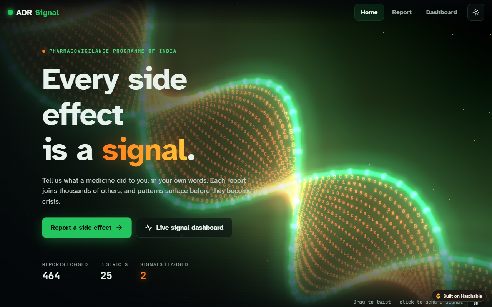
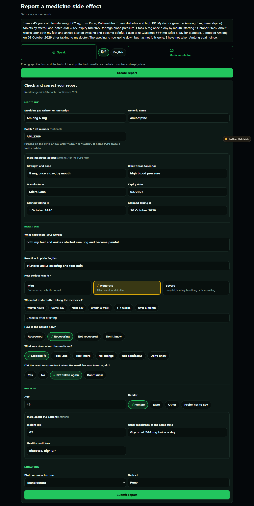
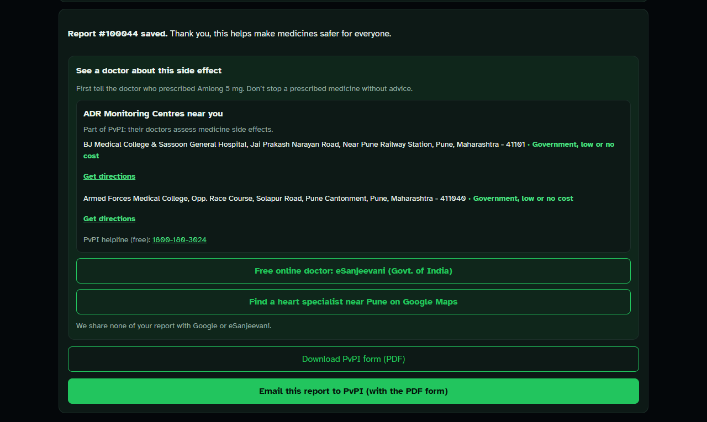
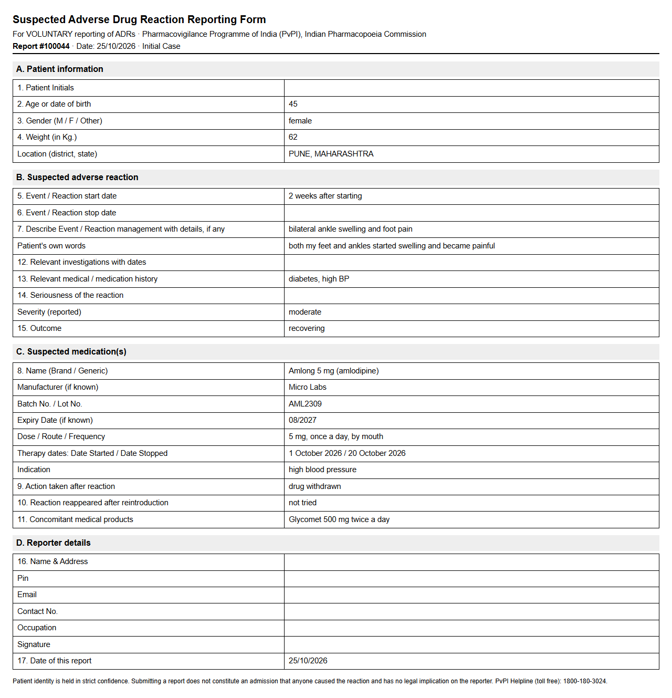
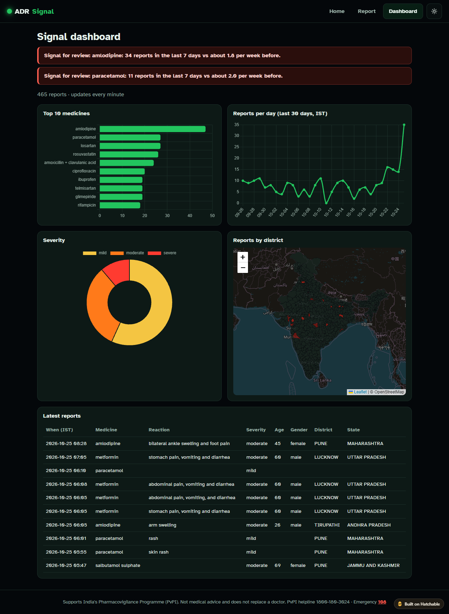
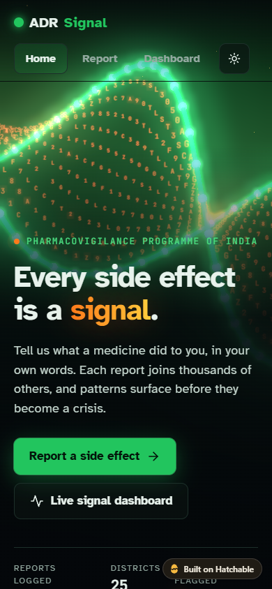
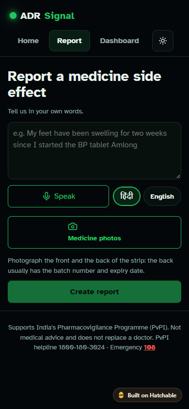
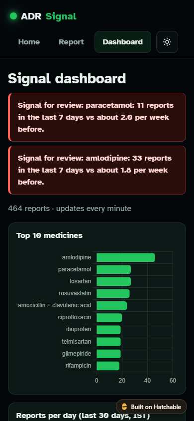
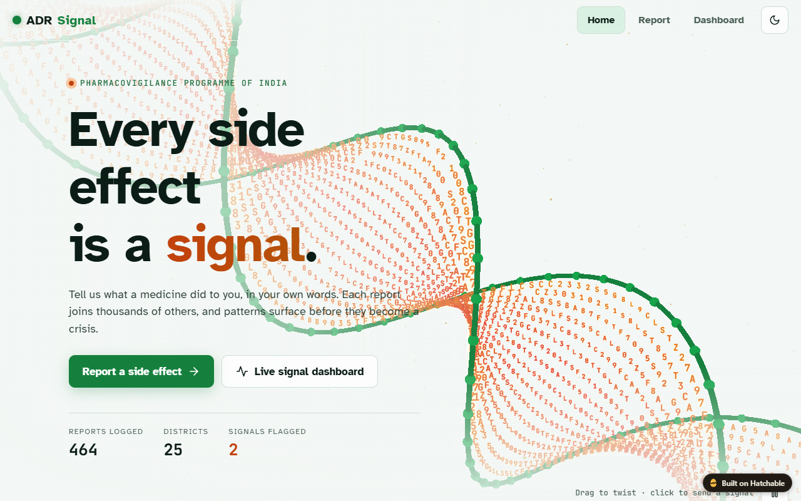

# ADR Signal

Adverse Drug Reaction (ADR) reporting for India, supporting the **Pharmacovigilance Programme of India (PvPI)**.
A patient or pharmacist describes a side effect in their own words (Hindi, Hinglish or English, typed or spoken, plus
photos of the medicine strip). The app fills in the PvPI Suspected ADR Reporting Form, emails it to PvPI with the
form as a PDF, points the reporter to the nearest ADR Monitoring Centre, and shows a live signal dashboard
that flags unusual spikes in reports.

Team **SapioCoders**. Live site: https://adr-signal.hatchable.site

> Not medical advice and does not replace a doctor. In an emergency call 108. PvPI helpline 1800-180-3024.



## Screenshots

### 1. Describe it in your own words; the AI fills the PvPI form

One plain sentence (or Hindi, Hinglish, voice, or a photo of the strip) becomes a checked, editable report:
medicine, generic name, batch, manufacturer, expiry, dose, dates, what was done, outcome, age, gender, weight,
other medicines, health conditions and location.



### 2. After saving: see a doctor, and send the report to PvPI

The nearest PvPI ADR Monitoring Centres (government first), eSanjeevani, a Google Maps search for the right
specialist, a printable PvPI form, and one button that emails the report to PvPI.



### 3. The filled PvPI Suspected ADR Reporting Form

The official form, ready to print or attach. The email links to it as a PDF.



### 4. Live signal dashboard

Spike alerts when a medicine's reports jump, plus top medicines, reports per day, severity and a district map.



### 5. On a phone

Built mobile-first: most reports will come from a phone at a pharmacy counter.

<table>
  <tr>
    <td></td>
    <td></td>
    <td></td>
  </tr>
  <tr>
    <td align="center">Home</td>
    <td align="center">Report: type, speak or add photos</td>
    <td align="center">Dashboard</td>
  </tr>
</table>

### 6. Light mode



## Features

- **Home**: interactive 3D DNA helix (Three.js), dark and light mode.
- **Report** (`client/src/Report.jsx`)
  - Free text, or voice in Hindi or English (Chrome/Edge Web Speech API).
  - Up to 3 photos of the strip, box or prescription.
  - AI reads every PvPI field: medicine, generic name, batch, expiry, manufacturer, dose, dates, action taken, rechallenge, other medicines, history, weight, age, gender, district. Without AI, a keyword fallback reads the text.
  - Phone numbers, emails and Aadhaar-like numbers are masked before the AI sees the text.
  - Red-flag "call 108" warning for severe reactions.
  - "See a doctor" step: nearest PvPI ADR Monitoring Centres, eSanjeevani (free government tele-consult) and a Google Maps search for the right specialist.
  - Printable PvPI form (`client/src/PvpiForm.jsx`), and an "Email this report to PvPI" button: the email links to the filled form as a PDF.
- **Dashboard** (`client/src/Dashboard.jsx`)
  - Top medicines, reports per day (IST), severity, and a district map.
  - Spike alerts: last 7 days at least 2× the prior weekly average, and at least 8 reports.

## Folder layout

| Folder | What it is |
|---|---|
| `client/` | React + Vite front end |
| `server/core.js` | All server logic (extraction, validation, privacy masking, seed data), shared by local and Hatchable |
| `server/index.js` | Local dev server: Express + SQLite |
| `hatchable/` | Hatchable deployment: `api/` endpoints, `migrations/` (Postgres), `hatchable.toml` (secrets), `lib/` |
| `data/` | Medicine list, PvPI ADR Monitoring Centre list, India district map |
| `docs/` | PvPI form fields, judge Q&A, pitch facts |

## Run locally

Needs Node 22.5 or newer (uses the built-in `node:sqlite`).

```sh
cd server
cp .env.example .env   # add GEMINI_API_KEY (optional)
npm install
npm run dev            # API on http://localhost:3001

cd ../client
npm install
npm run dev            # open http://localhost:5173
```

The first start seeds 430 demo reports, with a planted amlodipine spike in Pune and Mumbai. Delete `server/adr.db` to reseed.
Locally the email button falls back to a ready-made Gmail draft, because PDF email needs Hatchable.

## Deploy on Hatchable

1. `node hatchable/sync.mjs` builds the client into `hatchable/public/`, and generates `hatchable/lib/core.js` and
   `hatchable/lib/drugs.js` from `server/core.js` and `data/reference/drugs.json`. Hatchable has no build step and can't import JSON.
2. Upload the contents of `hatchable/` to the Hatchable project and deploy. Migrations in `hatchable/migrations/` run once each.
3. On the project's Setup page, paste `GEMINI_API_KEY` (to read photos and Hindi text).

Notes:
- The client must stay a single bundle (`build.modulePreload: false`, no lazy imports), because Hatchable's deploy linter rejects `import.meta`.
- The report email goes to `jaypaldabsara@gmail.com` (demo inbox, set in `hatchable/api/email/[id].js` and
  `client/src/Report.jsx`). The real PvPI inbox is `pvpi.ipc@gov.in`. Hatchable's free plan only delivers email to the project owner.
- Free plan bandwidth is 500 MB a day. The dashboard refetches once a minute, and only while its tab is visible.

## API (Hatchable)

| Route | What it does |
|---|---|
| `GET /api/reports` | all reports (real + demo) |
| `POST /api/reports` | save a report (`severity` must be mild, moderate or severe) |
| `POST /api/extract` | `{ text?, images?: [data URLs] }` → structured PvPI fields, `red_flag`, `source` |
| `GET /api/pvpi/:id` | the filled PvPI form as a page; `?format=pdf` for the PDF |
| `POST /api/email/:id` | email the report with a link to its PvPI form PDF, once per report |

## Check extraction

With the local server running, `node server/test-extract.mjs` runs `data/test-sentences.json` through `/api/extract`.

## Data sources

- District boundaries: https://github.com/datta07/INDIAN-SHAPEFILES (MIT). See `data/geo/README.md`.
- ADR Monitoring Centres: PvPI AMC list (September 2026), parsed by `data/reference/amc/parse_amc.py`.
- PvPI Suspected ADR Reporting Form v1.4: see `docs/pvpi-form-fields.md`.

## Known limitations

- Reports are public through `GET /api/reports`. A real deployment needs a login for PvPI staff and counts only for the public.
- The rate limit is per server instance, and descriptions are not length-capped yet.
- Reports reach PvPI by email only. There is no integration with PvPI's own reporting system.
